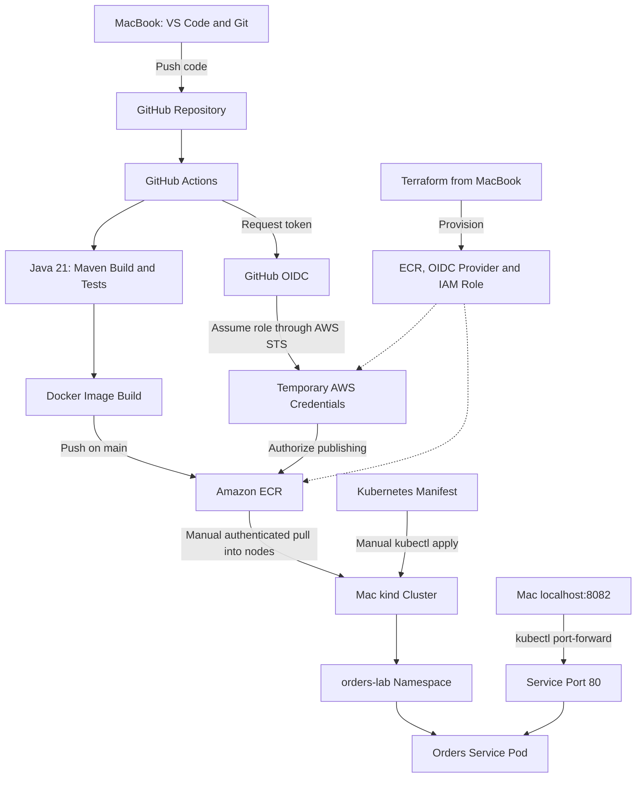

# Orders Service — Java CI/CD and Kubernetes Lab

A hands-on project for building, testing, containerizing, and deploying a Spring Boot application using Maven, Docker, GitHub Actions, AWS ECR, Terraform, and Kubernetes.

## Project Architecture



**Automation boundary:** GitHub Actions automatically builds, tests, and publishes the image. Loading the published image into kind and applying Kubernetes manifests are currently manual.

## Technology Stack

| Component | Technology |
|---|---|
| Application | Spring Boot 4.1.1 |
| Java | Eclipse Temurin JDK 21 |
| Build | Maven Wrapper |
| Container runtime image | eclipse-temurin:21-jre |
| Source control and CI | GitHub and GitHub Actions |
| Registry | Amazon ECR, us-east-1 |
| Infrastructure | Terraform |
| Kubernetes | Existing Mac kind cluster: my-first-cluster |
| Namespace | orders-lab |

## Repository Structure

```text
orders-service/
├── .github/workflows/ci.yml
├── .mvn/wrapper/maven-wrapper.properties
├── infra/
│   ├── main.tf
│   └── .terraform.lock.hcl
├── k8s/
│   └── orders.yml
├── src/
│   ├── main/java/com/example/orders_service/
│   │   ├── OrdersServiceApplication.java
│   │   └── OrdersController.java
│   ├── main/resources/application.yaml
│   └── test/java/com/example/orders_service/
│       └── OrdersServiceApplicationTests.java
├── .dockerignore
├── .gitignore
├── Dockerfile
├── mvnw
├── mvnw.cmd
├── pom.xml
└── README.md
```

## What We Completed

1. Installed Java 21 and verified the Maven Wrapper.
2. Generated a Spring Boot application with Web MVC and Actuator.
3. Added a GET /orders endpoint.
4. Built and tested the application, then ran the executable JAR.
5. Built a Docker image that runs as non-root UID/GID 10001.
6. Pushed source code to GitHub.
7. Created a GitHub Actions workflow for Maven verification and Docker builds.
8. Provisioned ECR, GitHub OIDC, an IAM role, and ECR push permissions using Terraform.
9. Published images to ECR using temporary OIDC credentials.
10. Pulled the published image into kind nodes.
11. Deployed the application with resource limits and health probes.
12. Verified the application and health endpoints through port-forwarding.

## Main Commands

Run project commands from:

```bash
cd ~/Documents/projects/orders-service
```

### Java and Maven

| Command | Explanation |
|---|---|
| `brew install --cask temurin@21` | Installs Java 21 JDK on the Mac. |
| `export JAVA_HOME=$(/usr/libexec/java_home -v 21)` | Selects Java 21 for the current shell. |
| `export PATH="$JAVA_HOME/bin:$PATH"` | Adds the selected Java tools to the shell path. |
| `java -version` | Displays the Java runtime version. |
| `javac -version` | Displays the Java compiler version. |
| `chmod +x mvnw` | Makes the Maven Wrapper executable. |
| `./mvnw -version` | Displays the project's Maven version and active JDK. |
| `./mvnw clean verify` | Compiles, tests, packages, and runs configured verification checks. |
| `ls -lh target/*.jar` | Lists the generated JAR artifacts. |
| `java -jar target/orders-service-0.0.1-SNAPSHOT.jar` | Starts the packaged application on port 8080. |
| `curl -sS http://localhost:8080/orders` | Calls the application directly on the Mac. |
| `curl -sS http://localhost:8080/actuator/health` | Checks application health. |

The Java exports above apply only to the current terminal session.

### Docker

| Command | Explanation |
|---|---|
| `docker info` | Displays Docker engine information. |
| `docker ps` | Lists running containers. |
| `docker build -t orders-service:v1 .` | Builds an image using the Dockerfile and packaged JAR. |
| `docker run -d --name orders-service -p 8081:8080 orders-service:v1` | Starts the container and maps Mac port 8081 to container port 8080. |
| `curl -sS http://localhost:8081/orders` | Calls the application running inside Docker. |
| `docker exec orders-service id` | Verifies the container's runtime user and group. |
| `docker stats --no-stream orders-service` | Displays a snapshot of container resource usage. |

The Dockerfile packages an already-built JAR, so Maven verification must run before the Docker build.

### Git and GitHub

| Command | Explanation |
|---|---|
| `git init -b main` | Initializes a new repository with main as its initial branch. |
| `git add .` | Stages project files that are not ignored. |
| `git diff --cached --stat` | Summarizes staged changes before committing. |
| `git commit -m "Describe the change"` | Saves staged changes in a local commit. |
| `git remote add origin git@github.com:isaradhi24/orders-service.git` | Connects the local repository to GitHub; run once. |
| `git push -u origin main` | Pushes main and establishes its upstream branch. |
| `git push` | Publishes subsequent commits and triggers the configured CI workflow. |
| `git status` | Displays the current branch and working-tree changes. |

### AWS and Terraform

| Command | Explanation |
|---|---|
| `aws sts get-caller-identity` | Identifies the AWS principal used by the local CLI. |
| `aws configure get region` | Displays the configured default AWS region. |
| `terraform version` | Displays the installed Terraform version. |
| `cd infra` | Enters the infrastructure configuration directory. |
| `terraform init` | Initializes the working directory and installs the AWS provider. |
| `terraform fmt` | Formats Terraform configuration. |
| `terraform validate` | Checks configuration syntax and internal consistency. |
| `terraform plan -out=ecr.tfplan` | Previews infrastructure changes and saves an execution plan. |
| `terraform apply "ecr.tfplan"` | Applies the saved plan to AWS. |
| `terraform output` | Displays the ECR repository URL and GitHub role ARN. |

Terraform provisions:

- ECR repository: orders-service, with immutable tags and scan-on-push requested.
- GitHub OIDC provider: token.actions.githubusercontent.com.
- IAM role: orders-service-github-ecr.
- Inline IAM policy: ECR authentication and repository-scoped push permissions.

Terraform state remains local in infra/ and is excluded from Git. Preserve it for future infrastructure changes. Commit .terraform.lock.hcl.

### ECR Authentication and Image Selection

Authenticate Docker to ECR using local AWS credentials:

```bash
aws ecr get-login-password --region us-east-1 |
  docker login \
    --username AWS \
    --password-stdin 905418207697.dkr.ecr.us-east-1.amazonaws.com
```

List published image tags:

```bash
aws ecr describe-images \
  --repository-name orders-service \
  --region us-east-1 \
  --query 'imageDetails[].{Tags:imageTags,Pushed:imagePushedAt}' \
  --output json
```

Select the image used for our first deployment:

```bash
export ORDERS_IMAGE="905418207697.dkr.ecr.us-east-1.amazonaws.com/orders-service:0bd6c340a2f5a500c2d10cf5fdadde5b8a501122-39330188083-1"
```

Pull it into Docker Desktop:

```bash
docker pull "$ORDERS_IMAGE"
```

### Load the ECR Image into kind Nodes

For this environment, we pulled directly into each node's containerd runtime:

```bash
ECR_PASSWORD=$(aws ecr get-login-password --region us-east-1)

for node in \
  my-first-cluster-control-plane \
  my-first-cluster-worker \
  my-first-cluster-worker2
do
  echo "Pulling image into $node"
  docker exec "$node" ctr --namespace k8s.io images pull \
    --platform linux/amd64 \
    --user "AWS:$ECR_PASSWORD" \
    "$ORDERS_IMAGE" || break
done

unset ECR_PASSWORD
```

This uses a temporary ECR password to download the selected image into the Kubernetes nodes. Do not print or commit the password.

Verify image availability:

```bash
docker exec my-first-cluster-worker crictl images
docker exec my-first-cluster-worker2 crictl images
```

### Kubernetes Deployment

| Command | Explanation |
|---|---|
| `kind get clusters` | Lists local kind clusters. |
| `kubectl config get-contexts` | Lists available Kubernetes contexts. |
| `kubectl --context kind-my-first-cluster get nodes` | Verifies nodes in the selected cluster. |
| `kubectl --context kind-my-first-cluster apply -f k8s/orders.yml` | Creates or updates the namespace, Deployment, and Service. |
| `kubectl --context kind-my-first-cluster -n orders-lab rollout status deployment/orders-service --timeout=180s` | Waits for the deployment rollout to complete. |
| `kubectl --context kind-my-first-cluster -n orders-lab get pods -o wide` | Displays pod readiness, IP addresses, and node placement. |
| `kubectl --context kind-my-first-cluster -n orders-lab port-forward service/orders-service 8082:80` | Makes the application accessible through localhost port 8082. |

Leave port-forwarding running and test from another terminal:

```bash
curl -sS http://localhost:8082/orders
curl -sS http://localhost:8082/actuator/health/readiness
curl -sS http://localhost:8082/actuator/health/liveness
```

Service port-forwarding selects a backing pod; it does not verify the full ClusterIP network path.

## GitHub Actions Workflow

| Stage | Purpose |
|---|---|
| Checkout | Downloads repository source onto the runner. |
| Java setup | Configures Temurin Java 21 and Maven caching. |
| Maven verification | Compiles, tests, and packages the application. |
| Docker build | Builds the image from the verified JAR. |
| AWS OIDC authentication | Exchanges the GitHub token for temporary AWS credentials. |
| ECR login | Authenticates Docker to the registry. |
| Image push | Publishes the image to ECR. |

- Pushes and pull requests targeting main run build checks.
- Publishing runs only for main, excluding pull-request events.
- Manual workflow execution is also available.
- Image tags contain commit SHA, workflow run ID, and run attempt.
- No long-lived AWS access keys are stored in GitHub.
- Scan findings are not yet used as a pipeline deployment gate.
- The generated application test passes; a dedicated /orders API test has not yet been added.

## Kubernetes Configuration

| Setting | Value / Purpose |
|---|---|
| Replicas | 1 |
| Container port | 8080 |
| Service | ClusterIP, port 80 |
| Image pull policy | IfNotPresent; uses the preloaded image |
| CPU request / limit | 100m / 1 CPU |
| Memory request / limit | 256Mi / 512Mi |
| JVM maximum heap | Approximately 50% of container memory |
| Startup probe | Allows application initialization before other probes begin |
| Readiness probe | Determines whether the pod should receive Service traffic |
| Liveness probe | Restarts the container after repeated probe failures |
| Runtime identity | Non-root UID/GID 10001 |

## Interview Walkthrough

“I built a Spring Boot service with Maven and packaged the verified JAR
into a non-root Docker image. GitHub Actions runs build checks and
publishes versioned images to Amazon ECR using OIDC and temporary AWS
credentials. Terraform manages the registry and IAM configuration.
I deployed the published image to kind with resource limits and
startup, readiness, and liveness probes, then verified the API and
health endpoints. CI is automated; deployment to the local cluster
is currently manual.”